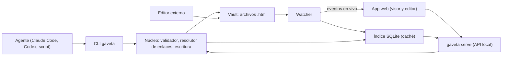
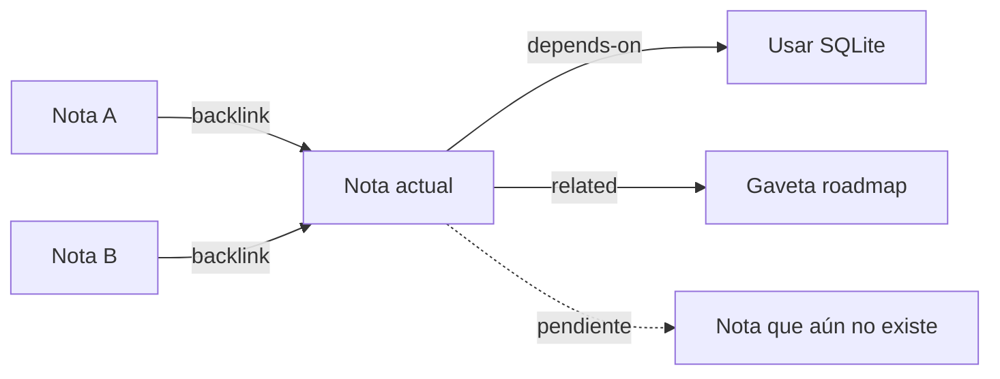
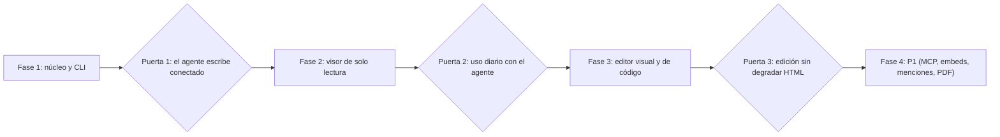

# Gaveta — PRD

Oct 22, 2026 · @Pedro Antonio Arenas Lara

> Documentos relacionados: [REQUIREMENTS.md](REQUIREMENTS.md) (requisitos trazables) y [TASKS.md](TASKS.md) (plan de tareas por fase).

## Resumen

Gaveta es una base de conocimiento local, al estilo Obsidian, donde cada nota es un archivo HTML y las conexiones entre notas son el centro del producto. No trae LLM propio: cualquier agente externo (Claude Code, Codex, un script) escribe y organiza el contenido a través de la CLI `gaveta`, y la app lo muestra y permite editarlo.

En v1 hay tres tipos de nota: documento, presentación y lista de tareas. Todas viven como `.html` en una carpeta (el vault), se abren en cualquier navegador y se versionan con git.

## Problema y oportunidad

Los agentes LLM ya generan HTML rico (tablas, slides, listas interactivas), pero ese HTML acaba disperso en chats, artifacts y archivos sueltos, sin relación entre sí.

- Las herramientas tipo Obsidian están pensadas para Markdown escrito a mano: el HTML rico no se ve ni se edita bien.
- Los artifacts de un chat no se enlazan entre ellos ni forman una base de conocimiento.
- Un agente no tiene una interfaz estable para "guarda esto conectado a aquello": escribe archivos a ciegas y rompe enlaces.

Oportunidad: un formato HTML con contrato claro, una CLI pensada para agentes y un visor con grafo de conexiones. Premisa a validar: que el HTML sea mejor soporte que Markdown para el contenido que producen los agentes.

## Principios de producto

1. **Archivos, no base de datos.** El vault es una carpeta de `.html`; el índice es una caché que se reconstruye.
2. **La conexión es lo primero.** Ningún flujo (crear, mover, renombrar, borrar) puede dejar enlaces rotos sin avisar.
3. **Agente primero, humano siempre.** Todo lo que hace la app se puede hacer por CLI con salida JSON; todo lo que escribe el agente se puede editar a mano.
4. **HTML semántico, estilo del vault.** Las notas usan los elementos y componentes del contrato; el aspecto lo pone el tema, no estilos inline.
5. **Seguro por defecto.** El HTML se muestra aislado y sin scripts arbitrarios.

## Objetivos y no-objetivos

El éxito de v1 es que un agente cree notas conectadas sin ayuda y que ningún enlace se rompa en silencio.

| Objetivo | Cómo se mide | Meta |
| --- | --- | --- |
| El agente escribe sin intervención | % de comandos de escritura del agente que pasan validación a la primera | ≥ 95 % |
| Cero enlaces rotos silenciosos | Enlaces rotos tras `mv`, `rm` o renombrar hechos con Gaveta | 0 |
| El conocimiento queda conectado | % de notas con al menos un enlace entrante o saliente | ≥ 80 % a los 30 días |
| Del agente a la pantalla al instante | Tiempo entre la escritura de la CLI y el cambio visible en la app (p95) | < 500 ms |
| Editable por humanos sin romper nada | Notas editadas en la app que siguen pasando `gaveta validate` | 100 % |

**No-objetivos de v1**

- **LLM integrado o chat dentro de la app.** El valor es ser el destino de cualquier agente; integrar uno ata a un proveedor.
- **Colaboración multiusuario en tiempo real.** Complejidad alta; v1 es local y de un solo usuario.
- **Sync en la nube y app móvil.** Git o una carpeta sincronizada cubren el caso en v1.
- **Ecosistema de plugins.** Primero hay que estabilizar el formato y la CLI.
- **JavaScript arbitrario dentro de las notas.** Riesgo de seguridad; la interactividad la dan componentes propios (ver Riesgos).

## Usuarios e historias de usuario

Gaveta tiene dos usuarios con necesidades distintas: el agente, que escribe por CLI, y la persona, que lee, navega y retoca en la app.

| Persona | Quién es | Qué necesita |
| --- | --- | --- |
| Desarrollador con agente (principal) | Trabaja con Claude Code u otro agente en terminal | Que documentación, decisiones y tareas queden ordenadas y conectadas |
| Agente (usuario de la CLI) | LLM que ejecuta comandos `gaveta` | Comandos deterministas, salida JSON y errores accionables |
| Lector/editor | La misma persona en otro momento, o un compañero | Navegar por contexto y corregir lo que generó el agente |

**Agente**

- Como agente, quiero leer el contrato de autoría (`gaveta guide`) para generar HTML válido a la primera.
- Como agente, quiero enlazar con `[[Título]]` y que la CLI lo resuelva al id, para no gestionar rutas.
- Como agente, quiero buscar si ya existe una nota sobre un tema para ampliarla en vez de duplicarla.
- Como agente, quiero leer los backlinks y vecinos de una nota para entender su contexto antes de escribir.
- Como agente, quiero editar una sección o marcar una tarea sin reescribir toda la nota.

**Persona**

- Como usuario, quiero ver en cada nota sus enlaces entrantes y salientes para navegar por contexto.
- Como usuario, quiero un grafo global y otro local para descubrir relaciones y notas huérfanas.
- Como usuario, quiero renombrar o mover una nota y que todos los enlaces se actualicen solos.
- Como usuario, quiero editar en modo visual y, cuando haga falta, en modo código.
- Como usuario, quiero presentar una nota de tipo presentación a pantalla completa.
- Como usuario, quiero marcar tareas en la app y que el cambio quede guardado en el archivo.
- Como usuario, quiero un aviso cuando un archivo editado fuera de Gaveta tenga enlaces rotos o HTML no válido.

## Arquitectura y modelo de datos

Un vault es una carpeta normal; Gaveta solo añade `.gaveta/` con configuración, tema e índice, y borrarla no pierde contenido.



El agente y la app escriben por el mismo núcleo; los cambios de un editor externo entran por el watcher y el índice nunca es la fuente de verdad.

```
mi-vault/
├── proyectos/
│   ├── gaveta-prd.html
│   └── gaveta-roadmap.html
├── reuniones/2026-10-22-kickoff.html
├── attachments/
└── .gaveta/
    ├── config.json
    ├── theme.css        # estilos del vault
    └── index.sqlite     # caché: enlaces, títulos, tareas, búsqueda
```

Cada nota es un documento HTML completo con sus metadatos en `<meta>`, para que se vea bien incluso abierta directamente en un navegador:

```html
<!doctype html>
<html lang="es">
<head>
  <meta charset="utf-8">
  <title>Gaveta — PRD</title>
  <meta name="gaveta:id" content="01JB7Z3K9QX4T5M2N8V6R0WYHC">
  <meta name="gaveta:type" content="doc">
  <meta name="gaveta:tags" content="producto, prd">
  <meta name="gaveta:aliases" content="PRD Gaveta">
  <meta name="gaveta:created" content="2026-10-22T10:00:00Z">
  <link rel="stylesheet" href="../.gaveta/theme.css">
</head>
<body>
  <article>…</article>
</body>
</html>
```

- `gaveta:id` (ULID) es la identidad estable; ruta y título pueden cambiar.
- La CLI calcula la ruta relativa al tema según la profundidad de la nota.
- El índice SQLite se reconstruye desde los archivos con `gaveta reindex`; los archivos son la fuente de verdad.
- Un watcher reindexa cualquier cambio, venga de la CLI, de la app o de un editor externo.

## Sistema de conexiones

Cada enlace es un `<a>` estándar que funciona en cualquier navegador y además guarda el id del destino, así sobrevive a renombrados y movimientos.



La nota sabe a quién enlaza y quién la enlaza; un enlace a una nota que aún no existe queda visible como pendiente en lugar de perderse.

```html
<a href="../decisiones/usar-sqlite.html"
   data-g-to="01JB8A2M4R7C9D1E3F5G7H9J0K"
   rel="depends-on">Usar SQLite</a>
```

- `href` relativo: la nota se navega aunque no exista Gaveta.
- `data-g-to`: id del destino. Si `href` y id no coinciden, manda el id y Gaveta repara el `href`.
- `rel` (opcional): tipo de relación. Vocabulario sugerido: `related`, `depends-on`, `part-of`, `supersedes`, `references`.

**Atajo de escritura.** El agente o la persona escriben `[[Título]]`, `[[Título|texto]]` o `[[Título#sección]]`. Al guardar, Gaveta lo convierte al formato canónico buscando por título y alias. Si el destino no existe, queda un enlace pendiente, visible en el grafo como nodo fantasma y listado por `gaveta doctor`.

| Capacidad | En la app | En la CLI | Prioridad |
| --- | --- | --- | --- |
| Enlaces salientes | Panel de conexiones | `gaveta links <nota>` | P0 |
| Backlinks con la frase donde aparecen | Panel de conexiones | `gaveta backlinks <nota>` | P0 |
| Grafo global y local (profundidad 1–3, filtros por tipo, tag y `rel`) | Vista grafo | `gaveta graph --json` | P0 |
| Renombrar o mover reescribiendo enlaces | Renombrar o arrastrar | `gaveta mv` | P0 |
| Borrado protegido (lista quién enlaza) | Diálogo de confirmación | `gaveta rm` (exige `--force`) | P0 |
| Enlaces rotos, pendientes y notas huérfanas | Panel de salud | `gaveta doctor` | P0 |
| Menciones no enlazadas (el título aparece sin enlace) | Botón "Enlazar" | `gaveta mentions <nota>` | P1 |
| Transclusión de una sección de otra nota | Bloque embebido | `<gaveta-embed>` | P1 |

Los tags y las carpetas también organizan, pero no sustituyen al enlace: el grafo puede mostrar tags como nodos opcionales.

## CLI para agentes

La CLI es la única vía de escritura del vault: la usan el agente, la app y los scripts del usuario, y todos comparten la misma validación.

- **Salida doble:** legible por defecto, `--json` estable y versionado para agentes.
- **Entrada flexible:** argumento, archivo o stdin (`--from -`), para pasar HTML largo sin escapar.
- **Errores accionables:** código, mensaje y sugerencia. Ejemplo: `E_LINK_UNRESOLVED` con "No existe 'Roadmap'. ¿Quisiste decir 'Gaveta roadmap'?".
- **Ediciones parciales:** cambiar una sección o una tarea sin reescribir la nota.
- **Sin pisar al humano:** `--if-match <hash>` rechaza la escritura si la nota cambió desde la última lectura.

| Comando | Qué hace |
| --- | --- |
| `gaveta init [--agent-instructions]` | Crea el vault y, opcionalmente, un bloque de instrucciones para `CLAUDE.md` o `AGENTS.md` |
| `gaveta guide` | Imprime el contrato de autoría: elementos permitidos, componentes, tipos y ejemplos |
| `gaveta new <título> --type doc\|slides\|todo [--in carpeta] [--tags] --from -` | Crea una nota y resuelve sus `[[…]]` |
| `gaveta read <ref> [--as html\|text\|outline]` | Lee la nota entera o su esquema con ids de sección |
| `gaveta edit <ref> --section <id> --replace\|--append --from -` | Edición parcial |
| `gaveta search <consulta> [--type] [--tag]` | Búsqueda de texto completo |
| `gaveta links \| backlinks \| mentions <ref>` | Consulta de conexiones |
| `gaveta link <origen> <destino> [--rel] [--text]` | Añade un enlace sin tocar el HTML a mano |
| `gaveta graph [<ref> --depth N] --json` | Grafo global o local |
| `gaveta mv <ref> <destino>` | Mueve o renombra reescribiendo enlaces |
| `gaveta rm <ref> [--force]` | Borra; falla si tiene backlinks y no hay `--force` |
| `gaveta todo add\|check\|uncheck\|list` | Gestiona tareas |
| `gaveta validate [<ref>]` · `gaveta doctor` | Valida HTML y salud de conexiones |
| `gaveta serve` | Arranca la app en localhost |

`<ref>` acepta id, ruta o título; si un título es ambiguo, la CLI devuelve error con los candidatos.

```bash
$ gaveta search "base de datos" --json
$ gaveta new "Usar SQLite" --type doc --in decisiones --from - <<'EOF'
<article>
  <h1>Usar SQLite</h1>
  <p>Para el índice de [[Gaveta — PRD]] usamos SQLite porque…</p>
</article>
EOF
$ gaveta link "Gaveta — PRD" "Usar SQLite" --rel depends-on
```

## Tipos de nota

Los tres tipos comparten formato y conexiones; solo cambian la estructura del `<body>` y cómo los presenta la app.

| Tipo | Estructura HTML | Vista en la app | Interacción |
| --- | --- | --- | --- |
| Documento (`doc`) | `<article>` con `h1`–`h3` y secciones con `id` | Lectura con índice lateral | Edición visual y de código |
| Presentación (`slides`) | Un `<section class="slide">` por diapositiva; notas del ponente en `<aside class="notes">` | Miniaturas y modo presentación a pantalla completa | Navegación por teclado; exportar a PDF (P1) |
| Lista de tareas (`todo`) | `<ul class="tasks">` con `<li data-g-task>` y checkbox; `data-g-due` y `data-g-priority` opcionales | Lista con filtros por estado | Marcar en la app escribe `checked` en el archivo |

Las tareas también pueden vivir dentro de un documento; una vista "Tareas" que las agregue todas, enlazando a su nota de origen, queda como P1.

**Componentes del contrato.** P0: callout (`<aside class="callout" data-kind="info|warn">`), tabla, figura con imagen y bloque de código. P1: diagrama (`<pre class="mermaid">` renderizado por la app) y `<gaveta-embed>`.

## Visor y editor

La app es lectura primero: tres columnas con explorador (carpetas, tags, tipos), nota y panel de conexiones (salientes, backlinks, grafo local).

- **Render aislado:** cada nota se muestra en un iframe sandbox con CSP que bloquea scripts y recursos remotos; la app inyecta el tema del vault.
- **Tres modos:** lectura (por defecto), edición visual restringida a los elementos del contrato, y código con validación en vivo.
- **Bloques desconocidos:** el HTML que el editor visual no entiende se muestra como "bloque HTML" y solo se edita en modo código, para no degradarlo.
- **Autocompletado de `[[`:** búsqueda difusa por títulos y alias mientras se escribe.
- **Navegación:** paleta de comandos y búsqueda global (Cmd/Ctrl+K), pestañas, atrás y adelante.
- **Cambios externos en vivo:** lo que escribe el agente aparece al momento; si la persona está editando esa nota, se avisa y se muestra un diff en vez de sobrescribir.
- **Plataforma v1:** `gaveta serve` sirve la app web en localhost; app de escritorio en P2.

## Requisitos

P0 es lo mínimo para que Gaveta resuelva el problema; si se recorta algo de P0, el agente no puede escribir conectado o los enlaces se rompen. El detalle trazable de cada requisito está en [REQUIREMENTS.md](REQUIREMENTS.md).

**P0 — imprescindible**

1. **Vault y formato de nota**
   - [ ] Tras borrar `.gaveta/index.sqlite`, `gaveta reindex` reproduce el mismo grafo.
   - [ ] Una nota abierta directamente en el navegador se ve con el tema y sus enlaces navegan.
2. **Enlaces canónicos y `[[…]]`**
   - [ ] Dado `[[Roadmap]]` y una nota "Roadmap", al guardar (CLI o app) queda un `<a>` con `href` y `data-g-to`.
   - [ ] Si el destino no existe, queda como enlace pendiente y `gaveta doctor` lo lista.
3. **Backlinks y enlaces salientes**
   - [ ] Cada backlink muestra la frase donde aparece.
   - [ ] Se actualizan en menos de 500 ms tras guardar cualquier nota.
4. **Renombrar y mover sin romper**
   - [ ] Dadas 20 notas que enlazan a X, `gaveta mv X otra/ruta` reescribe los 20 `href` y `doctor` reporta 0 rotos.
5. **Borrado protegido**
   - [ ] `gaveta rm` de una nota con backlinks falla sin `--force` y devuelve la lista de notas afectadas.
6. **Grafo global y local** con filtros por tipo, tag y `rel`; los enlaces pendientes aparecen como nodos fantasma.
7. **CLI v1 con `--json`**
   - [ ] Todos los comandos aparecen en `gaveta guide` con ejemplo.
   - [ ] Códigos de error estables y documentados.
   - [ ] `--if-match` rechaza la escritura si el hash cambió.
8. **Tres tipos de nota** con su vista; marcar una tarea en la app persiste `checked` en el archivo.
9. **Editor visual y de código** con validación contra el contrato.
10. **Render seguro**
    - [ ] Una nota con `<script>` o atributos `on*` no ejecuta nada y `gaveta validate` la marca.
    - [ ] Recursos remotos bloqueados por defecto.
11. **Búsqueda de texto completo** por CLI y en la app.

**P1 — siguiente iteración**

- Menciones no enlazadas con acción "Enlazar".
- Transclusión con `<gaveta-embed>`.
- `gaveta mcp`: los mismos comandos expuestos como servidor MCP.
- Vista agregada de tareas con filtros por fecha y prioridad.
- Exportar presentaciones a PDF y diagramas Mermaid.
- Plantillas por tipo de nota.

**P2 — a tener en cuenta en el diseño, fuera de v1**

- App de escritorio y app móvil.
- Sync entre dispositivos.
- Importar un vault de Obsidian (Markdown → HTML).
- Búsqueda semántica con embeddings.
- Colaboración multiusuario y plugins.

## Métricas de éxito

Todo se mide en local con `gaveta stats`, a partir del índice y de un log de comandos opcional; v1 no envía telemetría.

| Métrica | Tipo | Meta | Cuándo se evalúa |
| --- | --- | --- | --- |
| Comandos del agente sin error | Adelantada | ≥ 95 % | Semanas 1–2 |
| Errores de validación por nota creada por agente | Adelantada | < 0,2 | Semanas 1–2 |
| Latencia CLI → vista (p95) | Adelantada | < 500 ms | Continuo |
| Enlaces por nota creada | Adelantada | ≥ 2 | Semanas 1–2 |
| Notas conectadas (≥ 1 enlace) | Retrasada | ≥ 80 % | Día 30 |
| Notas huérfanas | Retrasada | < 10 % | Día 30 |
| Enlaces rotos persistentes | Retrasada | 0 | Día 30 y 90 |
| Días con uso a la semana | Retrasada | ≥ 4 | Día 90 |

## Riesgos y preguntas abiertas

El mayor riesgo es la seguridad del HTML generado; el segundo, que el editor visual degrade el HTML rico del agente.

| Riesgo | Impacto | Mitigación |
| --- | --- | --- |
| HTML inseguro (XSS) generado por un LLM o pegado | Alto | Iframe sandbox, CSP y saneado al guardar |
| El editor visual degrada HTML rico | Alto | Editor restringido al contrato; lo desconocido queda como bloque solo editable en código |
| El agente escribe fuera del contrato (estilos inline, `div` sin semántica) | Medio | `gaveta guide`, validación con errores accionables y normalizador |
| Persona y agente editan la misma nota a la vez | Medio | `--if-match`, watcher y diff antes de sobrescribir |
| HTML más verboso que Markdown: diffs de git ruidosos y más tokens | Medio | Formateo canónico al guardar; `read --as outline\|text` para leer barato |

**Preguntas abiertas**

Las propuestas de resolución están en [REQUIREMENTS.md — Decisiones propuestas](REQUIREMENTS.md#decisiones-propuestas-a-las-preguntas-abiertas).

- [ ] ¿CLI en Go (binario único) o en TypeScript (compartir validador con la app)? — Ingeniería, bloqueante para la fase 1.
- [ ] ¿Sobre qué base se construye el editor visual y cómo mapea los componentes del contrato? — Ingeniería, bloqueante para la fase 3.
- [ ] ¿Vocabulario de `rel` cerrado o abierto por vault? — Producto.
- [ ] ¿Archivo HTML completo (portable) o solo `<article>` + metadatos (menos ruido)? — Producto e ingeniería, bloqueante para la fase 1.
- [ ] ¿Imágenes remotas permitidas o descargadas siempre a `attachments/`? — Seguridad.
- [ ] ¿Alias corto del binario (`gv`)? — Producto.

## Fases y roadmap

La CLI y las conexiones van primero porque el agente es quien más escribe; la app se construye encima de un núcleo ya probado.



La fase 2 es solo lectura a propósito: permite usar Gaveta a diario con el agente antes de invertir en el editor, la parte más arriesgada.

> Nota: el diagrama de roadmap del PRD original era contenido embebido no exportado. Este diagrama lo reconstruye a partir del texto (4 fases, 3 puertas); el criterio concreto de cada puerta está en [TASKS.md](TASKS.md).
