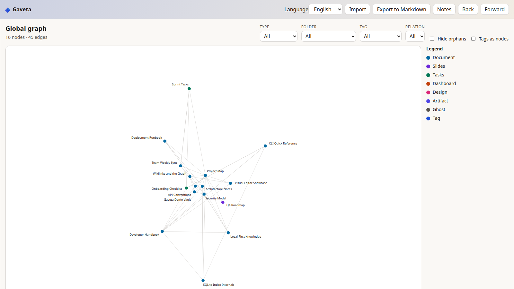
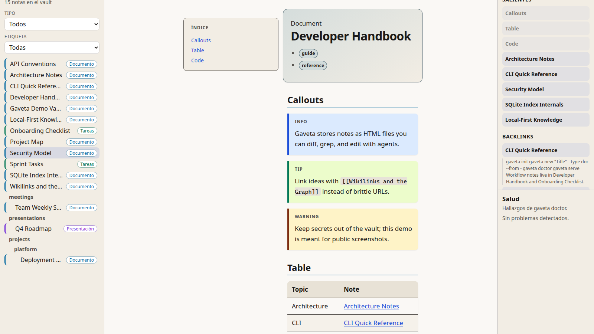

# Gaveta

Base de conocimiento local al estilo Obsidian: cada nota es un archivo HTML y los enlaces entre notas son el centro del producto.



> **Vista previa temprana (0.1.x)** — Desarrollo activo. La instalación recomendada es el script bash (checkout git, no npm).

[Documentación en inglés](../README.md) · [Roadmap](../ROADMAP.md) · [Contribuir](../CONTRIBUTING.md) · [Guía para agentes](../AGENTS.md)

## Por qué HTML y no Markdown

- **Documentos ricos** — Callouts, tablas, tareas, diapositivas y componentes de maquetación en el contrato de autoría.
- **Adecuado para agentes** — El HTML encaja con artefactos de Claude, Cursor y otros.
- **Notas autocontenidas** — Un archivo por nota: `file://`, git, archivado.
- **Los agentes escriben con la CLI** — El binario **`gaveta`** y la [skill de agente](#skill-de-agente) usan el mismo contrato que la app.

## Qué incluye

| Área | Qué obtienes |
| --- | --- |
| **Editores** | Editor visual (TipTap) y modo código (CodeMirror 6). |
| **Tareas** | Checkboxes en la app; **`gaveta todo`** en la CLI. |
| **Enlaces** | `[[wikilinks]]`, `data-g-to`, pendientes, backlinks, grafo. |
| **Markdown** | **`gaveta import`** / **`export`** (límites documentados en ida y vuelta). |
| **CLI** | **`gaveta`** / **`gv`**: init, notas, grafo, búsqueda, doctor, serve, MCP, … |
| **Local-first** | **`gaveta serve`** solo en **127.0.0.1**; índice SQLite FTS5; **Node ≥ 22.18**. |
| **i18n** | CLI y interfaz web en **inglés y español** (`--lang`, `GAVETA_LANG`, preferencia guardada en la web). |



## Instalación

**macOS (principal) y Linux.** Requiere **Node.js ≥ 22.18** y **git**.

```bash
curl -fsSL https://raw.githubusercontent.com/antonioaren/gaveta/main/install.sh | bash
```

Sin flags, el instalador:

- Clona o actualiza **`~/.local/share/gaveta`** desde **`main`** (clone completo para **`gaveta update`**)
- Ejecuta **`pnpm install`** y construye la app web
- Enlaza **`gaveta`** y **`gv`** en **`~/.local/bin`**
- Crea **`~/Gaveta`** si no existe
- Instala la skill si existen **`~/.cursor`** y/o **`~/.claude`**
- Escribe **`~/.local/share/gaveta/env.sh`** con **`GAVETA_VAULT`**

Opciones, desinstalación y actualizaciones: **[Instalación](installation.md)**.

## Inicio rápido

Tras instalar, abre una **nueva terminal** (o **`source ~/.local/share/gaveta/env.sh`**):

```bash
gaveta serve
```

Abre la URL **127.0.0.1** que imprime el comando.

Más detalle y primeras notas: **[Inicio rápido](quick-start.md)**.

## Skill de agente

Gaveta incluye una skill [Agent Skills](https://agentskills.io) generada desde el mismo origen que **`gaveta guide`**.

| Mecanismo | Comando | Destino |
| --- | --- | --- |
| **Skill** | `gaveta skill install --target cursor --scope user` | p. ej. `~/.cursor/skills/gaveta/` |
| **Reglas del vault** | `gaveta init --agent-instructions cursor` | `<vault>/.cursor/rules/gaveta.mdc` |

El instalador ejecuta **`skill install --scope user`** al detectar Cursor o Claude Code. **`gaveta skill status`** comprueba versiones.

Guía completa: **[Skill de agente](skill.md)**.

## MCP (Claude Code)

```bash
claude mcp add gaveta -- gaveta mcp
```

**[MCP](mcp.md)**

## Referencia CLI (resumen)

**`gaveta guide`** · **[Referencia CLI](cli-reference.md)**

## Estructura del vault

**[Estructura del vault](vault-structure.md)**

## Configuración

**[Configuración](configuration.md)**

## Desarrollo desde fuente

```bash
git clone https://github.com/antonioaren/gaveta.git
cd gaveta
corepack enable
pnpm install
pnpm check
pnpm dev
```

**[AGENTS.md](../AGENTS.md)** · **[Contribuir](../CONTRIBUTING.md)**

## Licencia

MIT — [LICENSE](../LICENSE)
