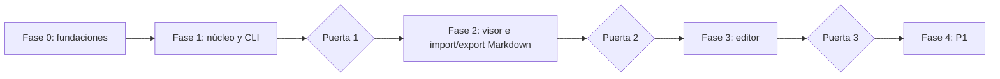
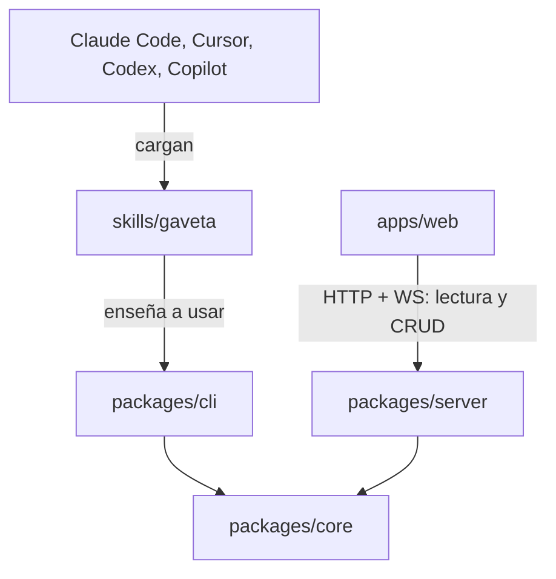
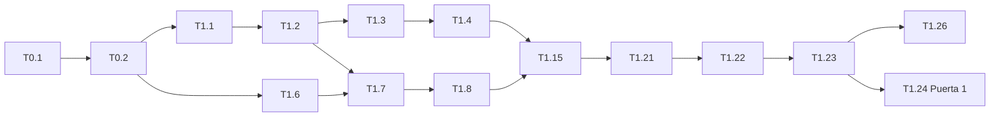

# Gaveta — Plan de tareas v1

Plan de ejecución del [PRD](PRD.md) a partir de los [requisitos](REQUIREMENTS.md). Cada tarea indica los requisitos que cubre y sus dependencias. Una tarea solo está terminada cuando sus criterios de aceptación tienen test y ese test pasa en CI.

**Convenciones**

- Id de tarea: `T<fase>.<número>`. Las dependencias se refieren a estos ids.
- Estado: `[ ]` pendiente, `[~]` en curso, `[x]` hecha.
- Cada tarea debería caber en un PR revisable. Si no cabe, se divide.

## Resumen de fases



| Fase | Objetivo | Puerta de salida |
| --- | --- | --- |
| 0 | Repo, herramientas y decisiones | Decisiones aprobadas (hecho), monorepo y CI en verde |
| 1 | Núcleo, CLI y skill: cualquier agente escribe notas conectadas | **Puerta 1:** un agente (Claude Code) crea al menos 20 notas conectadas usando solo la skill y `gaveta guide`. ≥ 95 % de los comandos de escritura pasan a la primera y `doctor` reporta 0 rotos tras `mv` y `rm`. |
| 2 | App de solo lectura sobre el núcleo, e importación y exportación de Markdown por CLI | **Puerta 2:** una semana de uso diario con el agente. Latencia CLI → vista p95 < 500 ms, 0 incidencias de seguridad en el render, y una carpeta Markdown real importada con 0 enlaces rotos. |
| 3 | CRUD completo en la app: crear, editar (visual y código), mover, renombrar y borrar | **Puerta 3:** el 100 % de las notas editadas en la app pasan `validate`, abrir y guardar sin cambios no altera ningún archivo, y cada operación de CRUD de la app produce el mismo archivo que su equivalente en la CLI. |
| 4 | Requisitos P1 | — |

## Arquitectura del repositorio (objetivo)

```
gaveta/
├── packages/
│   ├── core/        # contrato, parser, validador, normalizador, enlaces, índice, operaciones
│   ├── cli/         # binario gaveta / gv (commander), salida humana y --json
│   └── server/      # API local (Fastify) + watcher + WebSocket
├── apps/
│   └── web/         # React + Vite: visor (fase 2) y CRUD con editor (fase 3)
├── skills/
│   └── gaveta/      # SKILL.md (Agent Skills) para Claude Code, Cursor, Codex y Copilot
├── fixtures/        # vaults de prueba
└── docs/            # PRD, requisitos y tareas
```



**Stack (DEC-01, enmienda 2026-10-22):** TypeScript, Node ≥ 22, pnpm workspaces, `parse5` (parser HTML según el estándar), `node:sqlite` (índice con FTS5), `ulid`, `commander`, `chokidar`, Fastify, React + Vite, TipTap y CodeMirror 6 (fase 3), Vitest y Playwright.

---

## Fase 0 — Fundaciones

- [x] **T0.1 Aprobar las decisiones.** DEC-01 a DEC-08 aprobadas el 2026-10-22 y registradas en `REQUIREMENTS.md`.
- [x] **T0.2 Monorepo.** pnpm workspaces, TypeScript estricto, ESLint y Prettier, Vitest, y los paquetes vacíos `core`, `cli`, `server` y `web`. Depende de: T0.1.
- [x] **T0.3 CI.** GitHub Actions con lint, typecheck, tests con cobertura y análisis de seguridad en Linux y macOS (REQ-NFR-05). Windows queda para T4.8. Depende de: T0.2.
- [x] **T0.4 Vaults de prueba.** En `fixtures/`: un vault vacío, uno con 20 notas que enlazan a X (para REQ-LINK-09), uno con un problema de cada tipo (para REQ-LINK-11), notas maliciosas (para REQ-SEC-01 y 02) y un generador de vaults de 1000 y 5000 notas (para REQ-NFR). Depende de: T0.2.

## Fase 1 — Núcleo y CLI

### 1A. Contrato y formato

- [x] **T1.1 Módulo de contrato.** `core/contract.ts` como fuente única de los elementos, atributos, clases y componentes permitidos, y de la estructura de cada tipo. Cubre: el contrato de autoría, REQ-TYPE-01 a 05. Depende de: T0.2.
- [x] **T1.2 Parser y modelo de nota.** Leer el HTML con `parse5` y extraer metadatos, título, secciones, enlaces (canónicos, pendientes y `[[…]]`), tareas y texto plano. Cubre: REQ-VAULT-03. Depende de: T1.1.
- [x] **T1.3 Validador.** Reglas del contrato, seguridad y estructura por tipo, con códigos estables. Cubre: REQ-CLI-11, REQ-SEC-02, REQ-SEC-04, REQ-TYPE-02 y 03. Depende de: T1.2.
- [x] **T1.4 Normalizador y formateo canónico.** Saneado de lo inseguro, eliminación de estilos inline, ids de sección y de tarea que falten, ruta del tema según la profundidad y serialización determinista e idempotente. Cubre: REQ-FMT-01 y 02, REQ-SEC-03, REQ-VAULT-04, REQ-NFR-08. Depende de: T1.3.
- [x] **T1.5 Tema por defecto.** `theme.css` con los estilos de los tres tipos y de los componentes P0, que se vea bien con `file://` y cumpla el contraste AA. Cubre: REQ-VAULT-05, REQ-NFR-10. Depende de: T1.1.

### 1B. Vault, índice y enlaces

- [x] **T1.6 Vault y E/S segura.** Localizar el vault (`--vault`, `GAVETA_VAULT` o búsqueda ascendente), escritura atómica, protección de rutas y `config.json`. Cubre: REQ-VAULT-01, REQ-CLI-13, REQ-SEC-05. Depende de: T0.2.
- [x] **T1.7 Índice SQLite.** Esquema (`notes`, `aliases`, `links`, `sections`, `tasks`, `fts`), `reindex` completo e incremental, y tolerancia a archivos corruptos. Cubre: REQ-VAULT-06 y 07, REQ-NFR-03 y 07. Depende de: T1.2, T1.6.
- [x] **T1.8 Resolutor de referencias y enlaces.** Resolver `ref` (id, ruta o título/alias, sin distinguir mayúsculas ni acentos), convertir `[[…]]` a canónico o a pendiente, sugerencias por similitud, reparar `href` desde `data-g-to` y política de `rel`. Cubre: REQ-LINK-01 a 05, REQ-CLI-08. Depende de: T1.7.
- [x] **T1.9 Promoción de pendientes.** Al crear una nota, convertir en canónicos los pendientes que coinciden con su título o alias. Cubre: REQ-LINK-02. Depende de: T1.8.
- [x] **T1.10 Operaciones transaccionales `mv` y `rm`.** Reescritura en bloque de los `href` entrantes con reversión si falla algo, ruta del tema recalculada y, con `--force`, conversión de los enlaces entrantes a pendientes. Cubre: REQ-LINK-09 y 10. Depende de: T1.8.
- [x] **T1.11 Consultas de grafo.** Grafo global y local (profundidad de 1 a 3), filtros, nodos fantasma y contexto de los backlinks. Cubre: REQ-GRAPH-01 a 03, REQ-LINK-06 y 07. Depende de: T1.7.
- [x] **T1.12 Doctor.** Rotos, pendientes, huérfanas, duplicados y notas no válidas, más `--fix`. Cubre: REQ-LINK-11. Depende de: T1.8, T1.3.

### 1C. CLI

- [x] **T1.13 Esqueleto de la CLI.** `commander`, alias `gv`, sobre `--json` versionado, códigos de salida, entrada por `--from` y stdin, y salida legible por defecto. Cubre: REQ-CLI-01 a 03, DEC-06. Depende de: T1.6.
- [x] **T1.14 `init` y `adopt`.** `init [--agent-instructions claude|agents]` con un bloque delimitado e idempotente, y `adopt <ruta>`. Cubre: REQ-VAULT-01, 02 y 08. Depende de: T1.13, T1.4.
- [x] **T1.15 `new`, `read` y `edit`.** Creación completa (normalizar, resolver, validar y escribir), `read --as html|text|outline` con `hash`, edición parcial por sección y `--if-match` en todas las escrituras. Cubre: REQ-CLI-04 a 07. Depende de: T1.13, T1.4, T1.8, T1.9.
- [x] **T1.16 Comandos de conexiones.** `links`, `backlinks`, `link` (idempotente) y `graph`. Cubre: REQ-LINK-06 a 08, REQ-GRAPH-01 a 03. Depende de: T1.15, T1.11.
- [x] **T1.17 `mv` y `rm`.** Cubre: REQ-LINK-09 y 10. Depende de: T1.15, T1.10.
- [x] **T1.18 `todo`.** `add`, `check`, `uncheck` y `list` sobre cualquier nota, con diff mínimo. Cubre: REQ-TYPE-04. Depende de: T1.15.
- [x] **T1.19 `search`.** FTS5 con fragmentos resaltados y filtros. Cubre: REQ-CLI-10. Depende de: T1.7, T1.13.
- [x] **T1.20 `validate`, `doctor` y `reindex`.** Cubre: REQ-CLI-11, REQ-LINK-11, REQ-VAULT-06. Depende de: T1.12, T1.13.
- [x] **T1.21 `guide`.** Se genera desde el contrato y desde el registro de comandos, con `--json`, `--topic` y `--errors`. Incluye un test que comprueba que todos los comandos aparecen con un ejemplo. Cubre: REQ-CLI-09. Depende de: T1.14 a T1.20.

### 1D. Integración con Claude Code (validación de la puerta 1)

- [x] **T1.22 Skill de Gaveta.** `skills/gaveta/SKILL.md` en formato Agent Skills, más referencias breves (flujo de trabajo, ejemplos por tipo de nota). Explica cuándo usar Gaveta, buscar antes de crear, leer el contexto (`backlinks` y `graph --depth 1`), escribir con `new` o `edit --from -`, enlazar con `[[…]]`, usar `--json` y `--if-match`, validar, y remitir a `gaveta guide` para el contrato. Se genera desde el mismo origen que `guide`. Cubre: REQ-AGENT-01, REQ-AGENT-04 y 05. Depende de: T1.21.
- [x] **T1.23 Instalación de la skill por agente.** `gaveta skill install --target claude|cursor|codex|copilot|all [--scope project|user]` y `gaveta skill status`. Además, `init --agent-instructions` con un bloque corto en `CLAUDE.md`, `AGENTS.md`, `.cursor/rules/gaveta.mdc` y `.github/copilot-instructions.md`. Cubre: REQ-AGENT-02 a 04, REQ-VAULT-02. Depende de: T1.22, T1.14.
- [ ] **T1.26 Prueba de la skill en varios agentes.** La misma tarea de documentación ("documenta este repo en Gaveta, conectando las notas") ejecutada con Claude Code, Cursor, Codex y GitHub Copilot usando solo la skill instalada. Se registra qué agentes la cargan, la tasa de éxito a la primera y los fallos de cada uno, en `docs/gates/fase-1-agentes.md`. Depende de: T1.23.
- [ ] **T1.24 Prueba de la puerta 1.** Una sesión guionizada con Claude Code (con la skill instalada) sobre un vault vacío que genera al menos 20 notas (documentos, una presentación y listas de tareas) y registra la tasa de éxito a la primera, los enlaces por nota y el resultado de `doctor` tras varios `mv` y `rm`. Los resultados se guardan en `docs/gates/fase-1.md`. Depende de: T1.23.
- [x] **T1.25 Tests E2E de la fase 1.** Un test por cada criterio de aceptación P0 de la fase 1, incluido el de `file://` con Playwright (REQ-VAULT-05). Depende de: T1.21.

## Mejoras

- [x] **T1.29 Versionado y `gaveta update`.** SemVer 0.1.0, `gaveta version` con commit git y método de instalación, `gaveta update` para checkouts git (fast-forward, assets del vault), `docs/releasing.md` y workflow de release en tag `v*`. Depende de: T1.13, T1.14, T1.20.
- [x] **T1.27 Refresco visual del tema.** Paleta más rica (acento, acentos por tipo `doc`/`slides`/`todo`, semánticos info/tip/warning/danger/success), tipografía y espaciado, modo oscuro automático y override `data-theme`, componentes pulidos (callouts Obsidian, tablas, código, blockquotes, badges, tareas, enlaces pendientes, cabecera de nota, índice, diapositivas), contrato ampliado en `contract.ts`, contraste AA con test automatizado, vitrina en `fixtures/showcase/` y E2E Playwright en claro/oscuro. Cubre: REQ-VAULT-05, REQ-NFR-10. Depende de: T1.5.

## Fase 2 — Visor de solo lectura e importación y exportación de Markdown

### 2A. Visor

- [x] **T2.1 Servidor local.** `gaveta serve`: Fastify en `127.0.0.1`, API de lectura sobre el núcleo (`notes`, `read`, `links`, `backlinks`, `graph`, `search`, `doctor`), token de sesión y validación de `Origin`. Cubre: REQ-CLI-12, REQ-SEC-06. Depende de: fase 1.
- [x] **T2.2 Watcher y eventos.** `chokidar`, reindexado incremental y WebSocket con `note:changed|added|removed|moved`. Incluye una medida automática de la latencia de la CLI a la vista. Cubre: REQ-APP-05, REQ-NFR-01. Depende de: T2.1.
- [x] **T2.3 Ruta de render aislado.** Endpoint `/render/:id` con CSP estricta y tema inyectado, más el script de puente de la app para la navegación por `postMessage`. Cubre: REQ-APP-02, REQ-SEC-01. Depende de: T2.1.
- [x] **T2.4 Estructura de la app.** React + Vite con diseño de tres columnas, explorador (carpetas, tags y tipos), pestañas e historial atrás y adelante. Cubre: REQ-APP-01 y 03. Depende de: T2.1.
- [x] **T2.5 Panel de conexiones.** Salientes, backlinks con contexto y grafo local. Cubre: REQ-APP-01. Depende de: T2.4.
- [x] **T2.6 Vista de grafo global.** Filtros por tipo, tag y `rel`, nodos fantasma con "Crear nota" (que deja el comando listo para copiar en esta fase) y tags como nodos opcionales. Cubre: REQ-GRAPH-04. Depende de: T2.4.
- [x] **T2.7 Vistas por tipo.** `doc` con índice lateral, `slides` con miniaturas y modo presentación, y `todo` con filtros (solo lectura). Cubre: REQ-APP-06. Depende de: T2.3.
- [x] **T2.8 Búsqueda y paleta.** Cmd/Ctrl+K sobre `search` y comandos de navegación. Cubre: REQ-APP-04. Depende de: T2.4.
- [x] **T2.9 Panel de salud y avisos.** Salida de `doctor` y aviso cuando un cambio externo rompe enlaces o el contrato. Cubre: REQ-APP-07. Depende de: T2.2.
- [x] **T2.10 Tests E2E de seguridad y latencia.** Notas maliciosas de `fixtures/` y medida del p95. Cubre: REQ-SEC-01, REQ-NFR-01. Depende de: T2.3, T2.2.
### 2B. Importar y exportar Markdown (CLI)

Se adelanta a esta fase para poder usar Gaveta a diario con los documentos que ya existen. Solo depende del núcleo de la fase 1, no del visor, así que se puede desarrollar en paralelo a las tareas T2.1 a T2.10.

- [x] **T2.12 Fixtures Markdown.** DEC-07 (unified/remark/rehype) ya está aprobada. Preparar `fixtures/markdown/`: un vault de Obsidian de prueba con 50 notas y subcarpetas, wikilinks con alias y sección, enlaces relativos, tareas, callouts, tablas, mermaid, imágenes compartidas, una presentación Marp y casos no soportados. Depende de: fase 1.
- [x] **T2.13 Conversor Markdown → HTML** en `core/convert/md-to-html.ts`, con plugins para wikilinks, callouts, tareas, mermaid y slides. La salida pasa por el normalizador y el validador del núcleo. Cubre: REQ-MIG-04, REQ-MIG-01. Depende de: T2.12.
- [x] **T2.14 Importación de carpetas.** Recorrido recursivo con exclusiones, asignación de ids y resolución de enlaces en dos pasadas, copia de adjuntos deduplicada, `--dry-run`, `--on-conflict` y escritura atómica del lote (`--continue-on-error`). Cubre: REQ-MIG-02, 03, 05, 06 y 07. Depende de: T2.13, T1.10.
- [x] **T2.15 Conversor HTML → Markdown** en `core/convert/html-to-md.ts`, con `--links wiki|relative`, front matter, tareas, callouts, slides y `W_EXPORT_LOSSY` para lo que no se puede representar. Cubre: REQ-MIG-09 y 10. Depende de: T2.12.
- [x] **T2.16 `gaveta export`.** Una nota, una carpeta o `--all`, conservando la jerarquía y los adjuntos. Cubre: REQ-MIG-08. Depende de: T2.15.
- [x] **T2.17 Comandos `import` y `export` en la CLI**, con su sobre `--json`, sus códigos de error y sus ejemplos en `gaveta guide`. Cubre: REQ-MIG-01 a 10, REQ-CLI-09. Depende de: T2.14, T2.16.
- [x] **T2.18 Tests de ida y vuelta** (Markdown → HTML → Markdown y HTML → Markdown → HTML) sobre los fixtures. Cubre: REQ-MIG-11. Depende de: T2.17.
- [x] **T2.19 Skill: importar y exportar.** Añadir a la skill y a las instrucciones cómo importar documentación Markdown existente y cómo exportarla. Depende de: T2.17, T1.23.

### 2C. Puerta 2

- [ ] **T2.11 Prueba de la puerta 2.** Una semana de uso diario con el agente, que incluye importar al menos una carpeta de documentos Markdown reales. Los resultados se guardan en `docs/gates/fase-2.md`. Depende de: T2.1 a T2.10, T2.17.

## Fase 3 — Editor visual y de código

- [x] **T3.1 Esquema de TipTap.** DEC-02 ya está aprobada. Prototipar el esquema generado desde `contract.ts`, con el nodo `htmlBlock` para lo desconocido. Depende de: puerta 2.
- [x] **T3.2 API de escritura.** Endpoints de escritura en el servidor que llaman a las mismas operaciones del núcleo que la CLI, siempre con `if-match`. Cubre: REQ-APP-13. Depende de: T3.1.
- [x] **T3.3 Tareas interactivas.** Marcar y desmarcar desde la vista persiste `checked`. Cubre: REQ-APP-08. Depende de: T3.2.
- [x] **T3.4 Editor visual.** Componentes P0 y bloques HTML desconocidos conservados byte a byte. Abrir y guardar sin cambios no altera el archivo. Cubre: REQ-APP-09 y 10. Depende de: T3.1, T3.2.
- [x] **T3.5 Modo código.** CodeMirror 6 con validación en vivo usando el validador del núcleo. Cubre: REQ-APP-11. Depende de: T3.2.
- [x] **T3.14 Estilos del modo código bajo CSP.** Montar CodeMirror en un shadow root abierto (`EditorView({ root: shadowRoot })`) para que `style-src 'self'` no bloquee los estilos de la librería. Cubre: REQ-SEC-01, REQ-APP-11. Depende de: T3.5.
- [x] **T3.15 Capa base tipo VS Code.** Keymap de VS Code, búsqueda y reemplazo, plegado, multicursor, tema desde variables CSS, Ctrl+S y carga diferida del modo código. Cubre: REQ-APP-11. Depende de: T3.14.
- [ ] **T3.16 UX de problemas.** Avisos `W_*`, hover con código y mensaje, F8 / Shift+F8 y barra de estado con recuentos. Cubre: REQ-APP-11. Depende de: T3.14.
- [ ] **T3.17 Inteligencia HTML y Emmet.** Autocompletado acotado al contrato y Emmet (núcleo MIT). Cubre: REQ-APP-11. Depende de: T3.15.
- [ ] **T3.18 Paleta y «Formatear documento».** Comandos del editor en la paleta (T2.8) y formateo vía el normalizador del núcleo. Cubre: REQ-APP-04, REQ-APP-11. Depende de: T3.15.
- [ ] **T3.19 Abrir en VS Code.** Enlace `vscode://file/…` con ruta absoluta solo al hacer clic. Cubre: REQ-APP-11. Depende de: T3.5.
- [ ] **T3.6 Autocompletado de `[[`** en los dos modos (ítem 5 del plan VS Code / modo código). Cubre: REQ-APP-12. Depende de: T3.4, T3.5, T3.15.
- [ ] **T3.7 Conflictos.** Aviso y MergeView cuando la nota cambia fuera durante la edición (ítem 6 del plan VS Code). Cubre: REQ-APP-13. Depende de: T3.2, T2.2, T3.14.
- [x] **T3.8 Renombrar, mover y borrar desde la app**, con diálogo de backlinks. Cubre: REQ-APP-14. Depende de: T3.2.
- [x] **T3.11 Crear notas desde la app.** Botón "Nueva nota" y atajo de teclado, con selección de tipo, carpeta, tags y título. También desde un nodo fantasma o un enlace pendiente, con el título ya rellenado. Cubre: REQ-APP-17. Depende de: T3.2.
- [x] **T3.12 Carpetas, tags y alias desde la app.** Crear, renombrar y borrar carpetas (reescribiendo los enlaces de las notas que contienen), y editar tags y alias desde el panel de la nota. Cubre: REQ-APP-18. Depende de: T3.8.
- [~] **T3.13 Paridad entre app y CLI.** Tests que ejecutan cada operación de CRUD desde la API de la app y desde la CLI, y comprueban que producen archivos idénticos. Cubre: REQ-APP-18, DEC-08. Depende de: T3.3 a T3.12, T3.14 a T3.19.
- [x] **T3.10 Importar y exportar desde la app.** Arrastrar y soltar archivos o carpetas `.md` (o el menú "Importar") con una vista previa del `--dry-run` antes de confirmar, y "Exportar a Markdown" en una nota, en una carpeta y en el vault. Cubre: REQ-MIG-12. Depende de: T3.2, T2.17.
- [ ] **T3.9 Prueba de la puerta 3.** Pruebas de ida y vuelta sobre todas las notas de `fixtures/` y de la puerta 1. Los resultados se guardan en `docs/gates/fase-3.md`. Depende de: T3.3 a T3.8, T3.10 a T3.13, T3.14 a T3.19.

## Fase 4 — P1

- [x] **T4.1 `gaveta mcp`.** Servidor MCP por stdio con los mismos comandos (incluidos `import` y `export`) y el mismo sobre JSON. Se registra con `claude mcp add gaveta -- gaveta mcp`. Cubre: REQ-CLI-14, REQ-MIG-13.
- [x] **T4.2 Menciones no enlazadas** en la CLI y en la app ("Enlazar"). Cubre: REQ-LINK-12.
- [x] **T4.3 Transclusión con `<gaveta-embed>`.** Cubre: REQ-LINK-13.
- [ ] **T4.4 Vista agregada de tareas.** Cubre: REQ-APP-15.
- [x] **T4.5 Mermaid y exportación de presentaciones a PDF.** *(Adelantado: render Mermaid offline en `file://`; export PDF queda pendiente.)* Cubre: REQ-TYPE-06, REQ-APP-16.
- [ ] **T4.6 Plantillas por tipo.** Cubre: REQ-TYPE-07.
- [ ] **T4.7 `gaveta stats`** con un log local opcional. Cubre: REQ-CLI-15.
- [ ] **T4.8 CI en Windows.** Añadir `windows-latest` a la matriz de GitHub Actions (REQ-NFR-05). Aplazado al final del proyecto.

---

## Camino crítico de la fase 1



Se pueden trabajar en paralelo al camino crítico: T1.5 (tema), T1.11 (consultas de grafo), T1.12 (doctor), T1.19 (búsqueda) y T0.3 y T0.4 (CI y fixtures).

## Primeros cambios (este PR)

- [x] `docs/PRD.md`: PRD limpio, con los diagramas de arquitectura, conexiones y roadmap reconstruidos en Mermaid.
- [x] `docs/REQUIREMENTS.md`: requisitos trazables, decisiones aprobadas (DEC-01 a DEC-08), contrato de autoría y contrato de la CLI.
- [x] `docs/TASKS.md`: este plan.
- [x] T0.1: decisiones aprobadas.
- [ ] Siguiente paso: T0.4 (vaults de prueba).

## Mejoras

- [x] **T1.28 Artefactos Claude.** Tipos `dashboard`, `design` y `artifact`; `gaveta adopt` / `gaveta new --source claude`; fixtures `fixtures/claude/`; estilos en `theme.css`; README y e2e. Cubre: DEC-09, REQ-ART-01 a 06.
